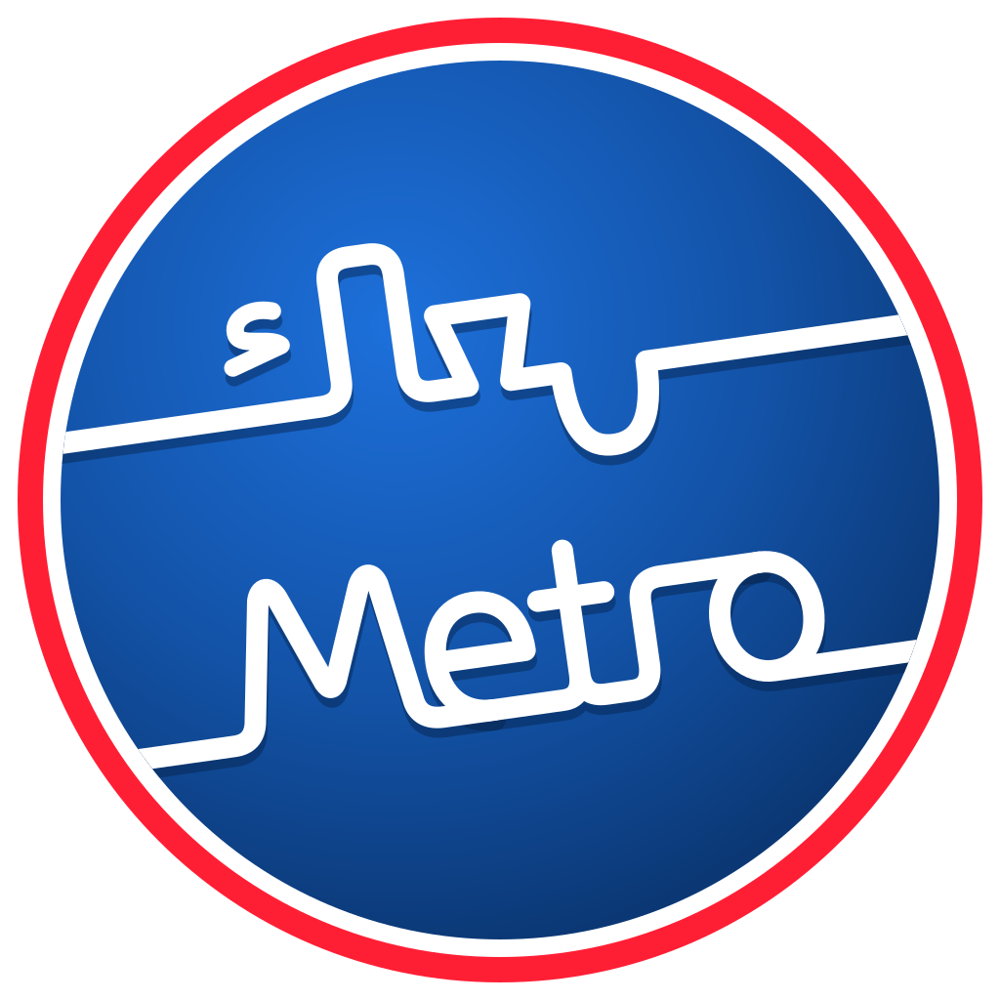

<div align="center">
  
  <h1>Maak Metro (معاك مترو)</h1>
</div>

> **Offline-first Cairo Metro route planner, fare guide and commuter companion for Android.**

[](https://github.com/HA2077/maak-metro/actions/workflows/ci.yml)
[](https://github.com/HA2077/maak-metro/releases)


**[Download Latest Android APK (GitHub Releases)](https://github.com/HA2077/maak-metro/releases)**

---

## Why Maak Metro?

Navigating Cairo's metro underground means zero cellular signal, busy interchange platforms, and multi-branch lines. **Maak Metro (معاك مترو)** is built to be fast, lightweight and 100% offline calculating optimal routes exact platform directions and color-coded ticket tiers in milliseconds without needing an internet connection.

---

## Live Route Walkthrough

Here is how **Maak Metro** guides a commuter from **Stadium** to **Al Shohadaa** in real time:

```text
┌─────────────────────────────────────────────────────────────┐
│  Route: Stadium → Al Shohadaa                               │
│  Estimated time: 25 min   [ Arrive ~5:18 AM ]               │
│  [ Yellow ticket ]   7 stations  •  1 change  •  EGP 10     │
├─────────────────────────────────────────────────────────────┤
│  ● Line 3 — Stadium                                         │
│    Direction: Rod El-Farag Corridor / Cairo University      │
│    ▾ 5 stops in between (tap each stop underground to check)│
│  ● Ataba                                                    │
├─────────────────────────────────────────────────────────────┤
│  ⇄ Change lines at Ataba                                    │
├─────────────────────────────────────────────────────────────┤
│  ● Line 2 — Ataba                                           │
│    Direction: Shubra El-Kheima                              │
│    1 stop (next station)                                    │
│  ● Al Shohadaa                                              │
└─────────────────────────────────────────────────────────────┘
```

### One-Tap Copy & Share Output

Tapping the copy icon on any route formats a clean summary ready to paste straight into WhatsApp or Messages:

```text
Maak Metro | Stadium → Al Shohadaa
25 min (Arrive ~5:18 AM) • 7 stations • 1 transfer
Yellow Ticket — EGP 10

1. Line 3: Stadium → Ataba (Dir: Rod El-Farag Corridor / Cairo University)
🔄 Transfer at Ataba
2. Line 2: Ataba → Al Shohadaa (Dir: Shubra El-Kheima)
```

---

## Core Features

### Offline Routing & Platform Directions
* **Custom Dijkstra Pathfinder:** Computes lowest-cost paths across Cairo's metro graph (`routing_graph.dart`, `dijkstra.dart`), accounting for line hops and interchange transfer penalties.
* **Branch-Aware Guidance:** Handles **Line 3's western split at Kit-Kat** (`Rod El-Farag Corridor` vs. `Cairo University`) and displays the exact terminus direction on every leg so riders board the right train.

### 2026 Ticket Color & Fare Engine
* **Instant Tier Classification:** Automatically maps trip station counts to official Cairo Metro ticket colors (**Yellow**, **Green**, **Pink**, and **Light Brown**) with accessible high-contrast badges and EGP pricing.

### Underground Ride Tools
* **Interactive "Live Ride" Stop Check-Off:** Expand intermediate stops inside any leg card and tap stations as you pass them underground—dimming completed stops and highlighting the upcoming station completely offline.
* **Pinch-to-Zoom Metro Schematic:** High-resolution offline Cairo Metro map (`InteractiveViewer`) accessible directly from both the **Planner** and **Lines** screens on a glare-free light canvas.
* **Estimated Arrival Clock & Reverse Trip:** Displays projected arrival time alongside trip duration, plus a one-tap **Reverse trip** button for instant return-journey routing.

### Bilingual Station Search (Arabic & English)
* **Native RTL & LTR Support:** Full English and Arabic localization (`app_en.arb`, `app_ar.arb`) with locale-aware digit formatting.
* **Arabic Normalization & One-Typo Tolerance:** Normalizes Alef variants (`أ/إ/آ → ا`), Teh Marbuta (`ة → ه`), Alef Maksura (`ى → ي`), diacritics and tatweel, then ranks exact, prefix, contains and one-typo matches across both station names.

### Daily Commuter QoL & Fast Cold Startup
* **SQLite Favorites & Recent History:** Star frequent commutes for 1-tap quick launch right from the Planner home screen, or swap origin and destination in a single tap.
* **Closed-Hours Advisory:** Detects Cairo Metro downtime (`12:15 AM – 5:15 AM`) and displays a non-blocking early-planning banner while keeping route planning unlocked.
* **Instant Cold Launch:** Renders frame 1 immediately while seeding and loading SQLite asynchronously via a single atomic `Batch` transaction.

---

## Cairo Metro Network & Fares

### Supported Lines (89 line-station rows / 84 unique stations)

| Line | Terminus Ways | Stops | Key Interchanges |
| :--- | :--- | :---: | :--- |
| **Line 1** (Blue) | `Helwan` ↔ `New El-Marg` | 35 | Sadat, Nasser, Al-Shohadaa |
| **Line 2** (Red) | `Shubra El-Kheima` ↔ `El-Mounib` | 20 | Al-Shohadaa, Attaba, Sadat, Cairo University |
| **Line 3** (Green) | `Adly Mansour` ↔ `Rod El-Farag Corridor` / `Cairo University` *(splits at Kit-Kat)* | 34 | Attaba, Nasser, Cairo University |

### Fare Brackets (Effective 27-03-2026)

| Ticket Color | Station Count | Fare (EGP) |
| :--- | :---: | :---: |
| **Yellow** | 1–9 stations | **10 EGP** |
| **Green** | 10–16 stations | **12 EGP** |
| **Pink** | 17–23 stations | **15 EGP** |
| **Light Brown** | 24+ stations | **20 EGP** |

---

## Architecture & Project Structure

**Maak Metro** follows a **feature-first Clean Architecture** separated into `domain`, `data`, and `presentation` layers, powered by `flutter_bloc` (`Cubit`) for predictable state management and `sqflite` for offline persistence.

```text
maak-metro/
├── .github/workflows/          # CI test runner (ci.yml) & tag APK release pipeline (release.yml)
├── android/                    # Kotlin Android host & native launch configuration
├── assets/
│   ├── fonts/                  # Bundled Noto Sans Arabic font family
│   ├── images/                 # App logo & high-res offline Cairo Metro schematic
│   └── metro_seed.json         # Versioned network graph, branches & fare brackets
├── docs/                       # Plan, screen design & official data sources
├── lib/
│   ├── core/
│   │   ├── data/               # SQLite database helper & schema migrations
│   │   ├── l10n/               # EN/AR ARB files & generated localizations
│   │   ├── motion/             # Haptics & reduce-motion aware animations
│   │   ├── theme/              # Light/Dark themes, line colors & ticket color tokens
│   │   └── utils/              # Arabic normalizer, station search, directions & time helpers
│   └── features/
│       ├── library/            # SQLite Favorites & trip history repository + UI
│       ├── network/            # Seed loader, lines/stations explorer & zoomable map sheet
│       ├── planner/            # Routing graph, Dijkstra engine, fare calculator & result UI
│       └── settings/           # Locale, theme appearance, onboarding & snapshot metadata
└── test/                       # Unit, seed-validation, repository & widget test suites
```

---

## Toolchain

Flutter `3.47.6` (stable) and Dart `3.13.5`. `pubspec.lock` is committed; do not regenerate it with a different SDK.

---

## Getting Started

### Prerequisites
* **Flutter SDK** (`3.47.6` stable) & **Dart SDK** (`3.13.5`)
* **Android SDK** (API 24+) or an Android emulator/device

### Run Locally

```bash
# 1. Clone the repository
git clone https://github.com/HA2077/maak-metro.git
cd maak-metro

# 2. Install dependencies
flutter pub get

# 3. Generate localization files (EN / AR)
flutter gen-l10n

# 4. Run on a connected Android device or emulator
flutter run
```

### Build Release APK

```bash
flutter build apk --release
```

The compiled APK will be generated at `build/app/outputs/flutter-apk/app-release.apk`.

### Run Automated Tests

```bash
flutter test
```

The test suite covers graph construction, Dijkstra routing, Line 3 Kit-Kat branch handling, fare bracket calculations, Arabic text normalization, `metro_seed.json` integrity, SQLite repositories, and screen widget tests.

---

## Documentation

* [`docs/design.md`](docs/design.md) — Screen design reference: visual tokens, components and screens
* [`docs/PLAN.md`](docs/PLAN.md) — Source of truth: architecture, seed format, SQL schema and router design
* [`docs/data-sources.md`](docs/data-sources.md) — Official sources, station order, interchanges and fare verification

---

## Acknowledgements

* **Cairo Metro Network & Fare Data:** Station sequences, interchange structures, and March 2026 fare brackets referenced from public releases by the **National Authority for Tunnels (NAT)**, the **Egyptian Company for Metro Management & Operation**, and **RATP Dev Mobility Cairo** (documented in [`docs/data-sources.md`](docs/data-sources.md)).
* **Open-Source Ecosystem:** Built with **Flutter** and **Dart**, powered by community packages including `flutter_bloc`, `sqflite`, `shared_preferences`, and `intl`.
* **Testing & Feedback:** Thanks to everyone who tested the app on device and emulator and sent feedback during development.
* **Academic Context:** Developed as part of an **Android Development** course project, with automated test verification and release APK builds powered by **GitHub Actions**.
* **License:** Released under the MIT License. See [`LICENSE`](LICENSE).

### Project Team
* **Hassan Ahmed / @HA2077**
* **Mahmoud Saleh / @bodysale5678az-svg**
* **Omar Sabeha / @Sabeha1337**
* **Youssif Walid / @logic0x01**
* **Abdulla Essam / @abdullaessam2006-rgb**
* **Ismail Hamada / @ih4525676-spec**

### Special Thanks
* Special thanks to **Mohamed Nabil / @Nabil2099** for architectural mentorship, guidance on clean `Cubit` state management, performance tuning and Flutter best practices throughout development.

---

**Maak Metro (معاك مترو)** • Built for Cairo commuters • Offline-first, fast and open source
